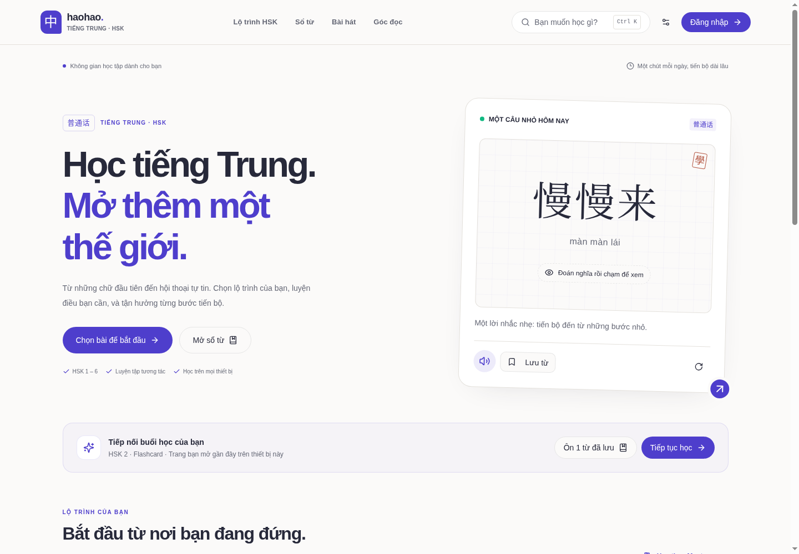
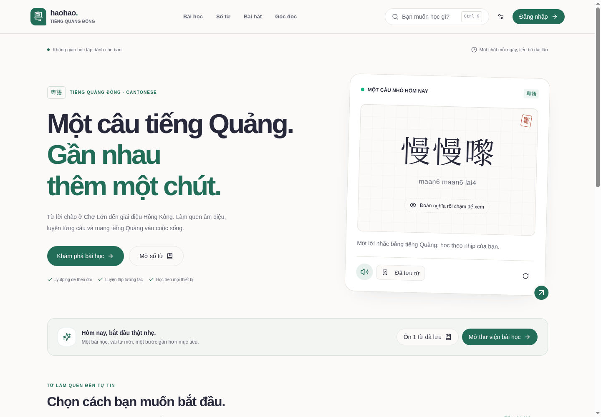
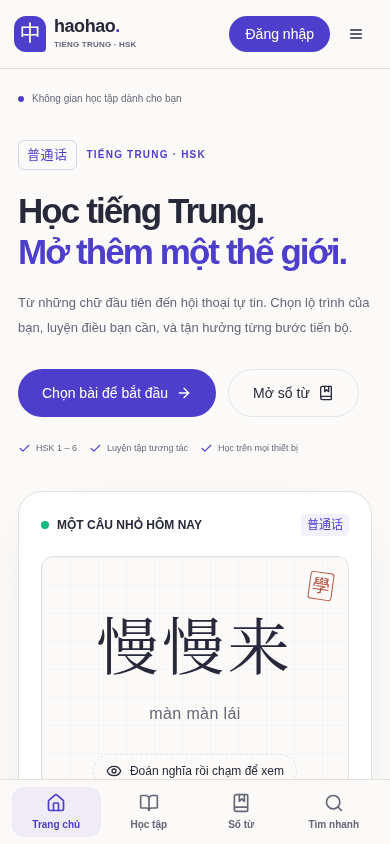
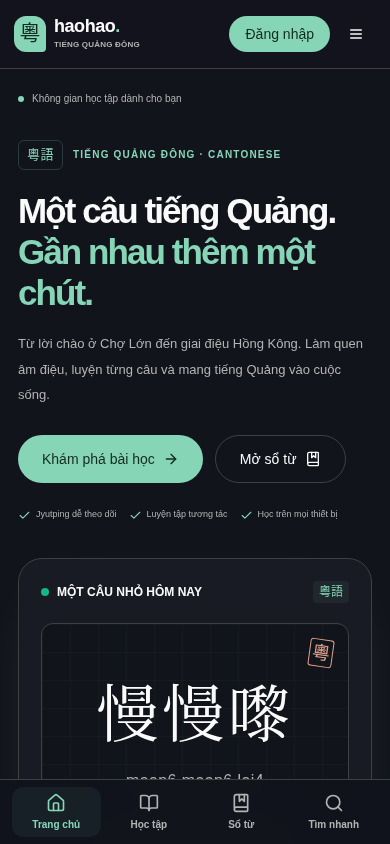
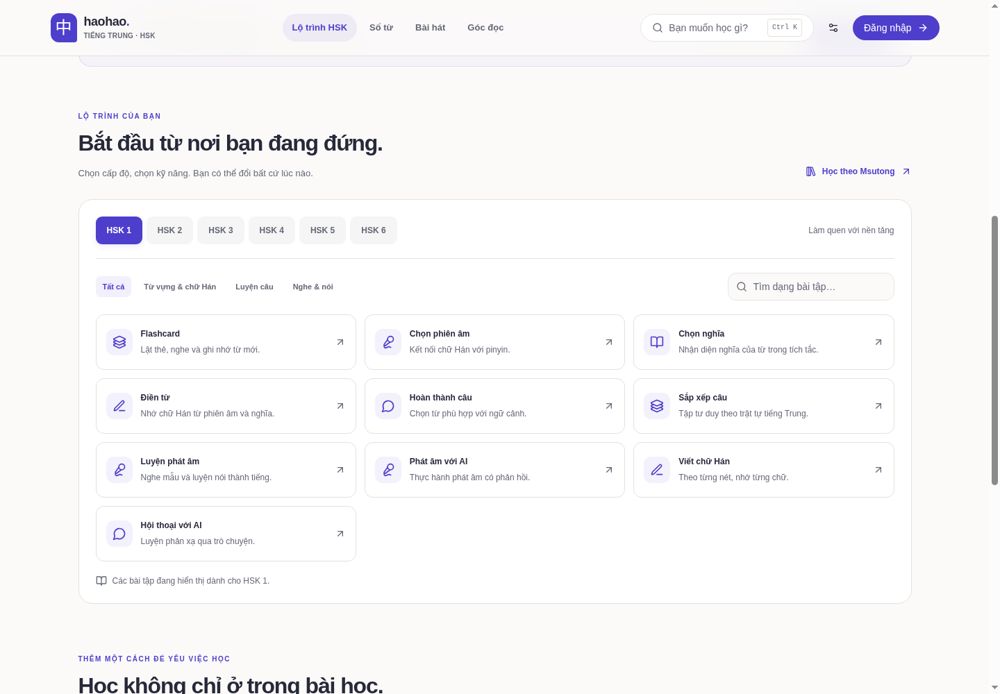

# HaoHao — nâng cấp giao diện và trải nghiệm học

Giao diện mới dùng nền giấy sáng, chữ đậm rõ thứ bậc và khoảng cách nhất quán. Tiếng Trung dùng tím chàm, tiếng Quảng Đông dùng xanh ngọc. Hai ngôn ngữ có chung cách điều hướng và điều khiển, cùng hỗ trợ giao diện tối.

## Những thay đổi có thể sử dụng ngay

- **Trang chọn ngôn ngữ:** hai lựa chọn là liên kết thật, sử dụng được bằng bàn phím; giới thiệu ngắn về nội dung từng ngôn ngữ.
- **Hai trang chủ:** đưa hành động bắt đầu học lên đầu, bổ sung câu gợi ý có phát âm, ẩn/hiện nghĩa, đổi câu và lưu vào sổ từ. Các công cụ học được gom thành các nhóm rõ ràng.
- **Lộ trình HSK:** chọn HSK 1–6 ngay trên trang, lọc theo kỹ năng và tìm dạng bài không cần dấu. Liên kết bài tập luôn theo cấp độ đang chọn; trạng thái không tìm thấy có nút xóa bộ lọc.
- **Điều hướng:** thanh đầu trang cố định, menu điện thoại, thanh dưới trên màn hình nhỏ, trạng thái trang đang mở, chuyển ngôn ngữ và tùy chọn Pinyin/Jyutping/sáng/tối.
- **Tìm nhanh:** mở bằng nút hoặc `Ctrl/Cmd K`, tìm công cụ và bài HSK; chọn bằng mũi tên và Enter, đóng bằng Escape.
- **Tiếp tục học:** trang chủ có thể mở lại trang bài học vừa truy cập. Địa chỉ được giới hạn trong các đường dẫn học hợp lệ, lưu riêng theo ngôn ngữ và tài khoản trên trình duyệt hiện tại. Đây là ghi nhớ trang đã mở, không phải số liệu hoàn thành bài học.
- **Thư viện Quảng Đông:** tìm theo tên/nội dung không dấu, lọc khóa học, chọn lưới/danh sách, khung chờ tải, lỗi có nút thử lại và hướng dẫn đăng nhập. Phạm vi bài học được hiển thị tiếp tục tuân theo quyền khóa học hiện có.
- **Thư viện bài hát ở cả hai ngôn ngữ:** cùng bố cục, tìm tên bài/nghệ sĩ không dấu, xử lý tải/lỗi/rỗng và khôi phục kết quả tìm kiếm.
- **Góc đọc và từ điển:** đồng bộ màu sắc, tiêu đề và ô tìm kiếm. Kết quả từ điển có nút xem chi tiết dùng được bằng bàn phím và lưu trực tiếp vào sổ từ.
- **Flashcard:** bề mặt và chữ dễ đọc hơn ở cả hai ngôn ngữ; thẻ tiếng Trung chỉ để nút âm thanh ở mặt đang hiển thị. Nút chuyển từ/đợt vừa màn hình nhỏ. Phím mũi tên không làm đổi thẻ khi người dùng đang nhập tìm kiếm; đổi cấp độ bắt đầu một đợt hợp lệ.
- **Khả năng tiếp cận:** liên kết bỏ qua điều hướng, nhãn điều khiển bằng tiếng Việt, tiêu đề trang theo đường dẫn, quản lý tiêu điểm khi chuyển trang và hỗ trợ `prefers-reduced-motion`. Ngôn ngữ tài liệu là `vi`.

## Ảnh xem trước

Ảnh được chụp bằng Chromium trong môi trường kiểm thử; dịch vụ Supabase được giả lập, không có dữ liệu tài khoản thật.

| Tiếng Trung — máy tính | Quảng Đông — máy tính |
| --- | --- |
|  |  |

| Tiếng Trung — điện thoại | Quảng Đông — điện thoại, giao diện tối |
| --- | --- |
|  |  |



## Kiểm tra

```bash
npm run lint
npm run typecheck
npm test
npm run test:browser
HSK_TEST_WIDTH=768 npm run test:browser
HSK_TEST_WIDTH=320 npm run test:browser
HSK_TEST_MOBILE=1 npm run test:browser
npm run build
```

- 16 kiểm thử Node.
- 44 tình huống trình duyệt, gồm kiểm tra hiển thị 20 đường dẫn thực tế, các luồng đăng nhập/quản trị/hồ sơ trước đó và các tương tác mới. Cùng bộ tình huống chạy ở chiều rộng 320, 390, 768 và 1440 pixel.
- Đã xem ảnh thực tế ở chế độ sáng/tối cho máy tính và điện thoại.
- Có thể tự chụp ảnh bằng `HSK_UI_CAPTURE_DIR=/tmp/haohao-ui npm run test:browser`. Các ảnh kiểm thử không đi vào bản build Vite.

Các kiểm thử trình duyệt dùng Supabase giả lập. Đăng nhập OAuth/email, RLS và RPC thật vẫn cần xác minh trên dịch vụ đang chạy. Sổ từ và địa chỉ bài học gần đây lưu trên trình duyệt; không đồng bộ giữa các thiết bị. Không có migration hoặc thay đổi dữ liệu sản xuất trong đợt này. Vite vẫn có cảnh báo về kích thước một số chunk; chưa có số đo hiệu năng trên dịch vụ thật.
